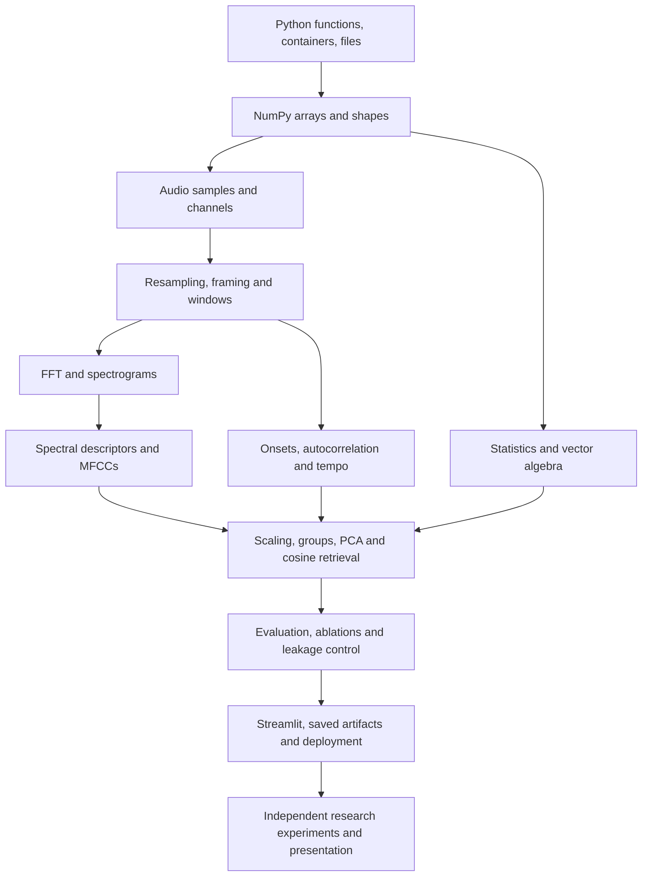

# seekaudio: from-scratch learning and reconstruction guide

This guide is for you as the developer, not only for a portfolio visitor. Its goal is to help you understand, reproduce, explain, and extend the system rather than memorize names.

Read it alongside the [technical report](TECHNICAL_REPORT.md), [method reference](METHOD_REFERENCE.md), and annotated Python files. The report explains the current implementation; this guide orders the prerequisites and practice.

## 1. How to use this guide

Use three passes:

1. **Run and observe:** follow a real recording through existing methods; inspect shapes and units.
2. **Rebuild small pieces:** implement one calculation with a controlled signal, compare it with the project, and write down why it works.
3. **Investigate choices:** run a controlled experiment and explain the evidence, including where you are uncertain.

Keep a learning notebook with four headings for every concept: **definition, equation, code, failure cases**. If you cannot explain the unit or array shape of a value, pause before adding more code.

The suggested sequence has twelve stages. A stage can take a few evenings or longer depending on your background. Treat the checkpoints as the completion criterion rather than an arbitrary calendar deadline.

Do not start with a neural model simply because the project concerns AI. First understand how the existing representation creates its similarity decisions.

## 2. Prerequisite map



There are two prerequisite branches: programming/mathematics and audio/signal processing. You need both before you can interpret a search score.

## 3. Establish a reproducible workspace

Work from the repository root. Use Python 3.12, matching the deployment environment.

```powershell
python --version
python -m venv .venv
.\.venv\Scripts\Activate.ps1
python -m pip install -r requirements.txt
python -m pip install -e ".[dev]"
python -m pytest tests -q
python -m streamlit run streamlit_app.py
```

If PowerShell blocks activation, you can use the environment interpreter directly:

```powershell
.\.venv\Scripts\python.exe -m pip install -r requirements.txt
.\.venv\Scripts\python.exe -m pytest tests -q
```

Avoid changing system-wide execution policies just to run the project.

Pinned versions protect saved-model compatibility. Use the sample's existing local file rather than adding download logic to every experiment. Do not commit credentials, large scratch outputs, or private recordings.

The `test` branch is annotated for study. Before changing behavior, keep a clear baseline commit. Saving a new feature recipe requires new artifacts, not merely a new column name.

## 4. Stage 1: refresh practical Python

### Learn

Variables, expressions, `if`, `for`, functions, return values, lists, sets, dictionaries, indexing, imports, exceptions, `Path`, and basic type hints.

Understand these project idioms:

- `str | Path` permits either type of path argument.
- `dict[str, float]` describes keys/values; it does not validate values at runtime.
- `-> pd.DataFrame` describes a return type.
- `**settings` unpacks a dictionary into keyword arguments.
- `features.update(other)` merges fields into a dictionary.
- `with` scopes resources such as an open file or temporary folder.
- `if __name__ == "__main__"` prevents importing a module from running its command.
- `@dataclass` organizes related configuration values.
- A leading underscore suggests an internal helper, not enforced access control.

### Read

`ingest.py`, `config.py`, and `__main__.py` before the heavier numerical files.

### Practice

Write a small function accepting a folder and returning only WAV paths. Then make it reject a missing folder with a useful exception. Construct one dictionary containing a track ID and technical fields. Do not load all music yet.

Experiment with `Path.stem`, `Path.parent.name`, and `Path.suffix.lower()` on the same file.

### Checkpoint

Explain why discovering a `.wav` path does not guarantee a readable WAV file. Show the difference between defining a function and calling it. Explain exactly what `**metadata` adds to a manifest row.

Primary resource: [Python 3.12 tutorial](https://docs.python.org/3.12/tutorial/).

## 5. Stage 2: NumPy, Pandas, and shapes

### Learn

NumPy arrays, dtypes, slicing, `shape`, `ndim`, transpose, axes, broadcasting, vectorized calculations, and copying versus views. Learn Pandas rows/columns, filtering, `groupby`, ID-based joins, and Parquet read/write.

Do not skip `axis`:

- Frames are `(frames, samples_per_frame)`.
- Averaging over `axis=1` produces one value per frame.
- MFCC output is `(coefficients, frames)`.
- Librosa spectra are `(frequency_bins, frames)`.
- `track_id` must not become a numeric model input.

### Practice

```python
import numpy as np

frames = np.array([[1.0, 2.0, 3.0], [4.0, 5.0, 6.0]])
print(frames.shape)
print(frames.mean(axis=0))
print(frames.mean(axis=1))
print(frames.T.shape)
```

Predict every output before running it. Next, create a three-track DataFrame, reorder its rows, and join metadata by ID. Demonstrate that joining by row position would be wrong.

### Checkpoint

Explain why a waveform is not a feature table. Given `(1288, 1025)`, say which axis means time and which means frequency. Explain why `features.columns` order must be saved.

Useful reference: [NumPy absolute beginners guide](https://numpy.org/doc/stable/user/absolute_beginners.html).

## 6. Stage 3: mathematics you actually need

### Learn

Arithmetic means, variance/std, square roots, logarithms, vectors, dot products, L2 norms, matrices, transpose, covariance, eigenvectors, and SVD at an intuitive level.

Learn notation rather than treating it as decoration:

- $\sum$: add values.
- $\sqrt{\cdot}$: square root.
- $\|\mathbf x\|_2$: Euclidean length.
- $\mathbf x^T\mathbf y$: dot product.
- $\mathbf1[\text{condition}]$: one if true, otherwise zero.
- $\arg\max$: index/value location of the largest score.
- $\log_{10}$ versus $\log_2$: different bases used for different purposes.

### Practice

For $[3,4]$, calculate norm 5 and normalized vector $[0.6,0.8]$. Calculate the cosine between $[1,0]$, $[0,1]$, and $[-1,0]$. Compute a mean/std from three values by hand.

Compare population std (divide by N) and sample std (divide by N-1). The project uses population pooling/std scaling and sample-variance PCA quantities.

### Checkpoint

Explain why dividing by a zero norm is invalid and how keeping the zero row unchanged avoids NaNs. Explain why negative PCA/MFCC values are not inherently errors.

## 7. Stage 4: understand digital audio

### Learn

Continuous versus sampled signals, PCM, sample rate, bit depth, channels, duration, Nyquist, aliasing, amplitude, dBFS, clipping, and floating-point sample representations.

Differentiate **sample rate** from **signal frequency**. A 1,000 Hz tone can be represented by many different sample rates if they are sufficient.

### Practice

Generate a tone:

```python
import numpy as np

sample_rate = 8_000
seconds = 1.0
frequency = 440
time = np.arange(round(sample_rate * seconds)) / sample_rate
waveform = 0.5 * np.sin(2 * np.pi * frequency * time)
print(waveform.shape)
```

Plot a tiny time section, not all samples at once. Listen to a safely scaled saved waveform if desired. Compare stereo channels with identical versus opposite signs and observe mono averaging.

### Checkpoint

Explain why a 30-second prepared clip has 661,500 samples. Explain what disappears when 48 kHz audio becomes 22.05 kHz audio. Explain why a full-file duration of 5:56 and a 30-second spectrogram can both be correct.

Read `features/audio.py` and the audio-preparation chapter of the report.

## 8. Stage 5: framing, windows, and the FFT

### Learn

Local stationarity, overlapping frames, frame/hop length, Hann window, spectral leakage, DFT/FFT, complex values, magnitude, power, bin frequency, and phase.

Calculate default window duration, hop duration, bin spacing, and frame count yourself. Confirm **1,288 complete frames**, not a rounded estimate from seconds times frame rate.

### Practice

Implement a readable framing loop in a separate exercise:

```python
frames = []
for start in range(0, len(waveform) - frame_length + 1, hop_length):
    frames.append(waveform[start:start + frame_length])
frames = np.array(frames)
```

Compare this with `split_into_frames`. The project helper uses a memory-sharing view for efficiency; your loop is valuable for understanding.

Calculate an FFT of a bin-aligned sine, then a non-bin-aligned sine. Compare no window versus Hann. Increase N while holding sample rate fixed and observe the change in time/frequency tradeoff.

### Checkpoint

Explain why FFT bin spacing is not a guarantee of perfect resolution. Explain why `rfft` has N/2+1 bins for even N. Identify the samples omitted at the end of the prepared clip.

Primary resource: [FMP STFT notebook](https://www.audiolabs-erlangen.de/resources/MIR/FMP/C2/C2_STFT-Basic.html).

## 9. Stage 6: rebuild energy and spectral descriptors

### Learn

RMS, magnitude weighting, centroid, bandwidth, cumulative rolloff, sign transitions, silence handling, and frame pooling.

### Practice in order

1. Implement RMS with a small loop, then compare with NumPy.
2. Calculate centroid for an isolated tone.
3. Calculate bandwidth around the centroid.
4. Find the 85% cumulative-magnitude crossing.
5. Count sign changes and divide by N-1.
6. Summarize frame measurements using mean/std.

Use three controlled inputs: silence, a sine wave, and deterministic noise. Then add two tones and vary their amplitudes.

### Expected observations

A tone's centroid is close to its frequency, bandwidth is narrow but not necessarily zero, and rolloff is nearby. Silence should not produce undefined values. Noise can increase spread and ZCR. The exact results depend on the signal and window.

### Checkpoint

Explain why ZCR is computed from raw frames rather than the FFT. Explain why centroid is not pitch. State whether this project's rolloff uses magnitude or power.

Read `energy.py`, `spectral.py`, and their tests. Run focused tests rather than rebuilding the entire catalog after each exercise.

```powershell
python -m pytest tests/test_energy.py tests/test_spectral.py -q
```

## 10. Stage 7: Mel spectrograms and MFCCs

### Learn

HTK Mel conversion, triangular filter banks, matrix multiplication, power-to-dB conversion, numerical floors, dynamic-range clipping, DCT, cepstral coefficients, and pooling.

Remember that the project computes custom MFCCs; its Librosa use is currently supplemental display analysis.

### Reconstruction sequence

1. Plot Hz versus Mel for a range of frequencies.
2. Generate M+2 boundary points.
3. Map boundaries to FFT bins.
4. Build and plot a few triangles.
5. Multiply frame power by the filter matrix.
6. Apply log compression and an 80 dB floor relative to the maximum.
7. Calculate DCT coefficients.
8. Retain twenty coefficients and pool them.

Inspect the shape after every step. An axis mistake can still produce plausible-looking numbers, so shape checks are essential.

### Practice questions

Why M+2 points for M filters? What happens when two low-frequency boundaries map to the same FFT bin? Why is log(0) a problem? What does DCT coefficient zero contain? Why does `mfcc_01` not mean the first nonzero-frequency component?

Compare the MFCC log matrix with the displayed spectrogram matrix. The display subtracts the maximum; the MFCC code does not.

### Checkpoint

Draw the MFCC flow from memory and explain what each arrow changes. Describe why changing to Slaney-normalized filters requires rebuilding the fitted catalog.

## 11. Stage 8: rhythm, tonal concepts, and Librosa

### Learn

Onset versus beat, autocorrelation, lag-to-BPM conversion, Gaussian smoothing, spectral flux, tempo priors, octave bands, spectral flatness, spectral contrast, pitch classes, and chroma.

### Practice

Generate pulses every 0.5 seconds. Calculate the expected tempo of 120 BPM. Inspect the RMS-rise envelope and its autocorrelation peaks. Then emphasize alternating pulses to create half-time ambiguity.

Compare:

- Stored `extract_rhythm_features`, using RMS rises.
- Display `extract_librosa_characteristics`, using spectral-flux tempo.
- A manually documented tempo reference, when reliable.

Record disagreements without assuming either estimate is automatically correct.

For optional chroma, generate A4 at 440 Hz and A5 at 880 Hz. Both should emphasize pitch class A. Generate mixed pitches and observe changes in chroma.

### Checkpoint

Explain why the same song can produce 63 BPM and 123 BPM estimates. Explain the role of Librosa's prior and why its maximum-tempo setting is not the same as the stored estimator's lower-and-upper interval.

Explain flatness and contrast without calling either a probability or a quality rating.

## 12. Stage 9: build the search representation

### Learn

Feature tables, fitting versus inference, StandardScaler, constant features, group normalization, weight effects, PCA centering, explained variance, whitening, and final L2 normalization.

### Practice

Start with a hand-made three-track table, not 999 recordings. Give one column values around 2,000 and another around 0.1. Observe unscaled Euclidean influence, then standardize.

Normalize two feature groups separately and change weights. Verify that doubling a unit group's weight produces a squared factor in the no-PCA cosine contribution.

Build a toy correlated table. Compare PCA with and without whitening and with fewer components. Plot the transformed points. Observe that PCA cares about variance, not genre.

### Critical exercise: saved transformation

Fit a scaler on the small catalog. Apply `transform` to a new row. Deliberately fit a second scaler on the query alone and observe the invalid comparison. Repeat this reasoning for PCA.

### Checkpoint

Explain the difference between per-column standardization, per-group normalization, and final vector normalization. Explain why the order matters and why the query cannot refit either model.

Read `space.py`, `test_space.py`, and the query-reuse test in `test_pipeline.py`.

## 13. Stage 10: retrieval, labels, and evaluation

### Learn

Cosine similarity, nearest-neighbor ranking, stable ties, self-exclusion, candidate sets, binary relevance, Precision@K, Recall@K, AP/MAP, nDCG, and random baselines.

### Practice

Construct four vectors with known directions and predict their scores before running retrieval. Use different IDs from row indices. Shuffle the manifest and confirm label joins remain correct.

Calculate the report's example relevance list $[1,0,1,1,0]$ by hand. Make a second list with the same three relevant results lower down. Explain which metrics change.

Use a small imbalanced genre catalog to derive the random expectation. Do not assume random precision is always 0.1; it depends on label counts.

### Classification versus retrieval exercise

For one query, write down:

- Neighbor IDs and labels.
- Same-genre retrieval precision.
- Majority-vote predicted genre.
- Whether that final genre prediction equals a separately known ground truth.

A query can have a correct majority label with poor retrieval precision, or vice versa. Averaging those outcomes creates different metrics.

### Checkpoint

Explain why excluding the query itself matters. Explain why an uploaded copy of a catalog track can still leak through a demonstration. Explain why recall near 0.05 at K=10 is interpretable when there are about 99 relevant candidates.

## 14. Stage 11: reproduce the experiments

### Learn

Ablation, controlled comparisons, hyperparameters, confounders, independent validation, paired comparisons, and cautious result interpretation.

### Practice

Read `config/ablation.yaml` and predict each experiment's dimensionality. Check A=40, B=8, C=5, D=48, E/F=53, G=40, H=27.

Run the recorded experiment suite:

```powershell
python -m src.seekaudio ablate
```

Then inspect `comparison.csv` and per-track reports. Keep new experiments in a separate output directory.

Write a short paragraph answering each question:

1. Why might MFCC-only beat the larger combined representation?
2. Does G versus E isolate PCA from whitening?
3. Does the experiment called “tuned” prove optimized weights?
4. Does 99.07% PCA variance retention imply almost perfect search?
5. What independent evidence would establish a real improvement?

### Checkpoint

Propose one experiment that changes only one factor. Specify what stays fixed, how settings are selected, and which score will judge it. Do not select a winning setting on the final test set and then report that score as unbiased.

## 15. Stage 12: understand the interface and deployment

### Learn

Streamlit reruns, widgets, session state, data/resource caches, content hashing, temporary files, saved-artifact paths, dependency pinning, and deployment branches.

### Practice

Trace `streamlit_app.main`:

1. Load configuration and cached catalog.
2. Select upload/sample.
3. Hash selected bytes and clear stale analysis.
4. Preview the full recording.
5. On button click, analyze.
6. Store the result dictionary.
7. Display genre, plot, and technical values.

Change the upload name while keeping identical content. Then change content while keeping the same name. Observe why content hashing is preferable to filename-only identity.

Explain why a cloud model folder must include both vectors and fitted transforms. Demonstrate that the generated deployment folder works without `data/raw`.

### Checkpoint

Explain why the webpage does not retrain models, why raw catalog paths need not exist on the deployed analysis-only app, and why a dependency update can require rebuilding or rechecking saved models.

Treat deployment as reproducible packaging, not as another opportunity to train secretly at startup.

## 16. Reconstruction milestones

Build a parallel exercise implementation in small files/notebooks. Do not overwrite the working baseline while learning.

| Milestone | Deliverable | Evidence you understand it |
|---|---|---|
| 1 | File inventory and one metadata record | Correct fields and invalid-file handling |
| 2 | Mono/resampled centered clip | Predicted shape and duration |
| 3 | Frame matrix and spectrum | Correct axes/bin frequencies |
| 4 | RMS and spectral summaries | Controlled-tone/silence tests |
| 5 | Mel filter bank and MFCC record | Shape trace and plotted triangles |
| 6 | Rhythm record | Known pulse tempo and ambiguity explanation |
| 7 | Raw catalog table | Finite values and unique IDs |
| 8 | Fitted scaler/group/PCA pipeline | Query transform reuse |
| 9 | Cosine search | Known-vector ranking and self-exclusion |
| 10 | Evaluation reports | Hand-calculated metric agreement |
| 11 | Controlled ablations | One-factor experiment design |
| 12 | Upload analysis and deployment bundle | UI result and artifact consistency |

A useful session format is 15 minutes of reading, 30-60 minutes of one experiment, and 10 minutes writing the result in your own words. Adjust the duration to your schedule; the purpose is regular evidence of understanding.

## 17. What to learn next for a stronger research project

### High priority

Independent classification evaluation, artist/duplicate grouping, train/development/test protocol, confusion matrices, macro-F1, confidence intervals, open-set behavior, and error analysis.

The current app's genre vote needs its own benchmark. A retrieval score cannot substitute for it.

### Medium priority

Robust scaling, carefully matched custom/library feature comparisons, multiple excerpt aggregation, temporal pooling alternatives, PCA-without-whitening, automatic weight search on development data, and model/data provenance hashes.

### Later extensions

DTW for aligned feature sequences, cover identification, pretrained audio embeddings, learned metric spaces, approximate-nearest-neighbor search, and larger music datasets.

These are research directions, not required prerequisites to explain the current system. Do not list them as implemented until there is working code and evaluation.

## 18. Interview and admission discussion practice

Prepare a two-minute explanation:

> I built a content-based music retrieval and audio-analysis system. I represent recordings with pooled timbral, spectral, energy, and rhythm features, transform them into a comparable vector space, and retrieve neighbors with cosine similarity. I compared eight representations using same-genre catalog relevance and added a demo with a neighbor-vote genre estimate and a Mel spectrogram. The current results are catalog measurements; independent generalization and perceptual validation remain future work.

Be ready to answer:

- Why 22,050 Hz and 30 seconds?
- What information does mono conversion discard?
- What does window size trade off?
- Why Mel filters and a DCT?
- How are MFCCs different from chroma?
- Why are magnitude and power weighting different?
- Why normalize groups after scaling columns?
- How do weights affect cosine similarity?
- What does whitening do?
- Why does MFCC-only currently outperform combined features?
- How do you transform an uploaded song consistently?
- Which Librosa values are display-only?
- Why is the genre output not calibrated?
- What makes GTZAN evaluation difficult?
- What would you do differently with independent test data?
- Which parts did you implement directly and which libraries did you use?

Say “I haven't measured that yet” when appropriate. A reasoned limitation is stronger than an invented certainty.

## 19. A practical mastery checklist

You are comfortable with this project when you can:

- Trace a file from waveform to feature dictionary to transformed vector.
- Predict the default shapes without running code.
- Derive RMS, centroid, bandwidth, rolloff, ZCR, cosine, and basic retrieval metrics.
- Explain the MFCC pipeline and the custom HTK choices.
- Explain both rhythm estimators and their ambiguities.
- Explain optional tonal features without claiming transcription.
- Reproduce one known-vector ranking and one metric example manually.
- Transform a query with saved objects and explain why refitting is wrong.
- Distinguish original metadata, excerpt statistics, retrieval features, and display-only features.
- State the observed results and their evidence paths.
- Design an independent evaluation with sensible grouping.
- Diagnose a stale UI result, missing artifact, or incompatible dependency.
- Explain the project clearly without reading its comments aloud.

## 20. Reading resources and order

Use official references and worked teaching material as supplements to your own experiments:

1. [Python 3.12 tutorial](https://docs.python.org/3.12/tutorial/) for syntax and program structure.
2. [NumPy beginner guide](https://numpy.org/doc/stable/user/absolute_beginners.html) for array reasoning.
3. [FMP notebooks](https://www.audiolabs-erlangen.de/resources/MIR/FMP/C0/C0.html) for music-processing concepts and Python examples.
4. [FMP STFT explanation](https://www.audiolabs-erlangen.de/resources/MIR/FMP/C2/C2_STFT-Basic.html) for the time-frequency step.
5. The technical report's linked SciPy, scikit-learn, and Librosa APIs for the exact functions you use.
6. [GTZAN analysis resources](https://github.com/boblsturm/GTZAN) before designing stronger evaluations.

Read a method, predict an output, run a tiny experiment, and then return to the reference. Reading documentation alone does not establish that your pipeline is correct.

## 21. Suggested personal research notebook template

For each experiment, record:

```text
Question:
Why it matters:
Baseline commit and feature version:
Dataset/candidate/query definitions:
Single changed factor:
Settings selected before test:
Expected observation:
Actual numerical result:
Listening or visual observation:
Possible confounders:
What the result does not prove:
Next experiment:
```

For a bug investigation, add **minimal reproducer**, **array shapes**, **dependency versions**, and **whether the issue is numerical, environmental, or a modeling assumption**.

This turns your project from an accumulation of functions into a technical learning record that you can explain and defend.

