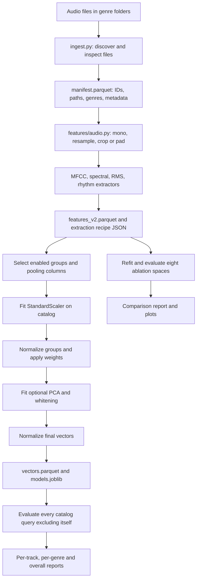
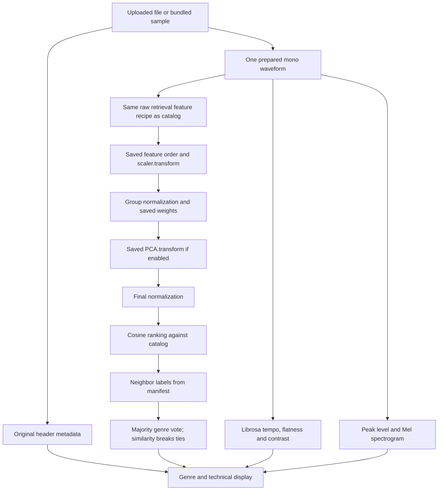

# seekaudio: technical reference report

**Implementation snapshot:** 12 October 2026.  
**Scope:** the current Python implementation, saved version 2 catalog, Streamlit analysis interface, and learning context.  
**Companion documents:** [Learning guide](LEARNING_GUIDE.md) and [Method reference](METHOD_REFERENCE.md).  
**Audience:** a developer returning to Python and preparing for further study in AI, analytics, and audio.

This is a reference document, not a claim of a new state-of-the-art algorithm. Implementation statements come from the repository's actual methods. Numerical results come from the saved evaluation artifacts. Background references are linked where useful; optional future work is explicitly distinguished from implemented behavior.

## Contents

1. [Purpose and research question](#1-purpose-and-research-question)
2. [MIR context and task boundaries](#2-mir-context-and-task-boundaries)
3. [Architecture and processing flows](#3-architecture-and-processing-flows)
4. [Dataset, metadata, and artifacts](#4-dataset-metadata-and-artifacts)
5. [Notation and default settings](#5-notation-and-default-settings)
6. [Digital audio preparation](#6-digital-audio-preparation)
7. [Frames, windows, and Fourier analysis](#7-frames-windows-and-fourier-analysis)
8. [Pooling and fixed-size representations](#8-pooling-and-fixed-size-representations)
9. [RMS energy](#9-rms-energy)
10. [Spectral descriptors](#10-spectral-descriptors)
11. [Mel filters and MFCCs](#11-mel-filters-and-mfccs)
12. [Stored rhythm features](#12-stored-rhythm-features)
13. [Optional tonal features](#13-optional-tonal-features)
14. [Librosa display analysis](#14-librosa-display-analysis)
15. [Search-space construction](#15-search-space-construction)
16. [Cosine retrieval and genre voting](#16-cosine-retrieval-and-genre-voting)
17. [Mel spectrogram and displayed measurements](#17-mel-spectrogram-and-displayed-measurements)
18. [Evaluation definitions and worked example](#18-evaluation-definitions-and-worked-example)
19. [Recorded results and interpretation](#19-recorded-results-and-interpretation)
20. [Implementation, configuration, and deployment](#20-implementation-configuration-and-deployment)
21. [Tests, complexity, and reproducibility](#21-tests-complexity-and-reproducibility)
22. [Limitations and next research steps](#22-limitations-and-next-research-steps)
23. [Glossary and misconceptions](#23-glossary-and-misconceptions)
24. [References and evidence](#24-references-and-evidence)

## 1. Purpose and research question

seekaudio analyzes a recording's measurable sound properties and uses those properties to compare it with a catalog. It has two related interfaces:

- A CLI retrieves acoustically similar catalog recordings.
- A Streamlit page accepts an uploaded song or bundled sample, estimates genre by voting over retrieved neighbors, and displays technical audio characteristics and a Mel spectrogram.

A suitable research question is:

> How do interpretable timbral, spectral, energy, and rhythm descriptors contribute to music retrieval under a same-genre relevance proxy?

The project examines representations, not just whether a UI can display a plausible label. The eight ablations are a controlled way to compare feature choices.

The application does not learn from listening history, user profiles, artist metadata, or song popularity. It does not identify an exact recording by an audio fingerprint, transcribe lyrics, separate instruments, or train a neural audio embedding. Its genre output is a nearest-neighbor decision rule over a fixed catalog.

There is still machine learning: the scaler and PCA are fitted to catalog data. PCA is unsupervised. Genre labels enter evaluation and the final voting rule, not the acoustic feature calculations or PCA fit.

## 2. MIR context and task boundaries

**Music Information Retrieval (MIR)** studies computational ways to analyze, organize, search, and interact with music. Music can be represented as audio, scores, symbolic events, metadata, or combinations of these. Audio retrieval by example is one MIR task: supply a recording and rank related recordings. The [FMP materials](https://www.audiolabs-erlangen.de/resources/MIR/FMP/C0/C0.html) provide a broader map of MIR topics and algorithms.

| Task | Question | Relationship to seekaudio |
|---|---|---|
| Acoustic content-based retrieval | Which recordings have similar measured sound? | Implemented |
| Genre estimation | Which catalog genre is most common among neighbors? | Implemented as a vote |
| Audio fingerprinting | Is this the same recording, including a short excerpt? | Not implemented |
| Cover/version identification | Is this another performance of the same composition? | Not implemented |
| Beat tracking | At which times do beats occur? | Not implemented; tempo is estimated |
| Music transcription | Which notes were played, and when? | Not implemented |
| Recommendation | What should this particular listener hear next? | No personalized recommendation model |
| Source separation | Which samples belong to vocals, bass, drums, etc.? | Not implemented |

**Timbre** concerns the sound character distinguishing sources with comparable pitch and level. MFCCs describe aspects of the spectral envelope; they do not directly label individual instruments.

**Musical similarity** is not one universally defined quantity. Two songs can share tempo but differ in instrumentation, share harmony but differ in production, or belong to different genres despite similar spectra. A cosine score in this project means similarity in its chosen representation.

## 3. Architecture and processing flows

### 3.1 Offline MIR catalog preparation



**Entry point:** `python -m src.seekaudio run`.  
**Coordinator:** `pipeline.run_pipeline()`.  
**Important:** the catalog is fitted during preparation, not whenever someone uploads audio.

### 3.2 Live MIR analysis flow



**Coordinator:** `analysis.analyze_audio()`.  
**UI entry point:** `streamlit_app.main()`.

The live path never calls `scaler.fit` or `pca.fit`. An uploaded query must enter the coordinate system learned from the catalog.

Librosa's additional display measurements branch off from the waveform. They do **not** change the saved 53-dimensional raw retrieval schema or catalog evaluation scores.

### 3.3 Representation sizes

| Object | Default shape | Meaning |
|---|---|---|
| Original decoded stereo audio | `(original_samples, 2)` | Decoder layout before mono conversion |
| Prepared mono waveform | `(661500,)` | 30 seconds at 22,050 Hz |
| Complete audio frames | `(1288, 2048)` | Frame-first layout |
| Real FFT magnitude/power | `(1288, 1025)` | Non-negative frequency bins |
| Custom Mel power | `(1288, 128)` | 128 Mel bands per frame |
| Selected MFCC matrix | `(20, 1288)` | Coefficient-first layout after transpose |
| Raw catalog feature table | `(999, 54)` | 53 numbers plus ID |
| Default PCA vector table | `(999, 41)` | 40 numbers plus ID |
| Librosa input spectrum | `(1025, 1288)` | Frequency-first layout |
| Display Mel matrix | `(128, 1288)` | Mel band versus time |

Numbers apply to the current defaults. They change with window sizes, duration, coefficient counts, group selection, or optional tonal features.

## 4. Dataset, metadata, and artifacts

### 4.1 Local catalog

The local GTZAN copy contains 1,000 discovered recordings arranged in ten genre folders. One file, `jazz.00054.wav`, cannot be decoded by SoundFile and is skipped with a warning. The saved manifest therefore has 999 usable entries: nine genres with 100 tracks each and jazz with 99.

GTZAN is useful for learning and baseline experiments, but its known repetitions, labeling issues, and recording artifacts require care. The [dataset analysis repository maintained by Bob Sturm](https://github.com/boblsturm/GTZAN) documents these concerns. This project has not performed a complete duplicate/artist/content audit.

### 4.2 Manifest fields

| Column | Definition | Example |
|---|---|---|
| `track_id` | Filename without extension | `blues.00000` |
| `path` | File path stored during ingestion | `data/raw/.../blues.00000.wav` |
| `genre` | Name of immediate parent directory | `blues` |
| `duration` | Original recording duration, seconds | About 30 |
| `sample_rate` | Original samples per second, Hz | 22050 |
| `channels` | Original channel count | 1 |

The genre is inferred from directory structure, not recognized from the header. IDs must be unique for search. Copies with the same stem in different folders can violate this assumption.

Metadata is not an MFCC, tempo, or spectral measurement. It describes the file's organization and technical properties.

### 4.3 Saved artifacts

| Artifact | Purpose |
|---|---|
| `data/manifest.parquet` | Catalog identity, genre labels and metadata |
| `data/features/features_v2.parquet` | Raw acoustic values |
| `data/features/features_v2.json` | Exact extraction settings and feature version |
| `data/space/vectors.parquet` | Ready-to-search catalog representation |
| `data/space/models.joblib` | Fitted scaler/PCA and deterministic transformation settings |
| `data/evaluation/current/` | Current catalog metrics and configuration |
| `data/evaluation/ablations/` | Scores and configurations for eight experiments |
| `data/evaluation/plots/` | Genre and ablation figures |
| `data/demo/sweet_child_o_mine.mp3` | Optional locally supplied sample |
| `deployment/streamlit/` | Generated small runtime bundle |

Parquet is a typed columnar table format. Joblib serializes Python model objects. JSON records readable settings. A model's column order and extraction recipe are as important as its fitted numeric parameters.

The web interface needs the manifest, vectors, models, source, dependencies, and configuration. It does not need raw GTZAN recordings because it no longer plays retrieved catalog tracks. Manifest paths can describe local Windows files without those paths being opened by the live analysis-only interface.

## 5. Notation and default settings

| Symbol | Meaning |
|---|---|
| $x[n]$ | Prepared mono sample at index $n$ |
| $f_s$ | Sample rate in Hz |
| $L$ | Number of prepared samples |
| $N$ | Samples per frame; `n_fft` |
| $H$ | Hop length between frame starts |
| $T$ | Number of complete frames |
| $F=N/2+1$ | Real FFT bins for even $N$ |
| $M$ | Number of Mel bands |
| $C$ | Retained MFCC coefficient count |
| $N_c$ | Number of catalog tracks |
| $D$ | Number of raw selected feature columns |
| $P$ | PCA component count |
| $K$ | Number of retrieved neighbors |
| $A_{t,k}$ | Spectral magnitude in frame $t$, bin $k$ |
| $P_{t,k}$ | Spectral power, $A_{t,k}^2$ |
| $\mathbf{v}_i$ | Final representation of catalog track $i$ |

Defaults: $f_s=22050$, duration 30 seconds, $N=2048$, $H=512$, $M=128$, $C=20$, $D=53$, $P=40$, and $K=10$.

`feature_spec_version=2` identifies the stored retrieval recipe. Adding display-only Librosa values does not change its raw columns. Changing an extractor definition would require a new version and rebuilding compatible artifacts.

## 6. Digital audio preparation

### 6.1 Sampling and channels

Continuous sound pressure is represented digitally by samples:

$$
x[n] \approx x_{\mathrm{continuous}}(n/f_s).
$$

Hz means cycles per second for frequency and samples per second for sample rate. These are related units but different concepts.

For $C_h$ decoded channels, mono conversion is an arithmetic mean:

$$
x_{\mathrm{mono}}[n]=\frac{1}{C_h}\sum_{c=1}^{C_h}x_c[n].
$$

This simplifies downstream shapes and computation. Opposite-phase stereo content can cancel; mono conversion does not preserve every spatial property. The UI still reports the original file's channel count.

### 6.2 Resampling

For source rate $f_o$ and target $f_s$:

$$
g=\gcd(f_o,f_s),\quad
u=f_s/g,\quad d=f_o/g.
$$

`resample_poly` performs filtered rational resampling by factors $u,d$. Filtering suppresses frequencies incompatible with the lower target rate; simply taking every other sample is not an adequate general resampler. See the [SciPy API](https://docs.scipy.org/doc/scipy/reference/generated/scipy.signal.resample_poly.html) for implementation parameters.

For 48,000 to 22,050 Hz, $g=150$, $u=147$, $d=320$.

**Nyquist frequency** is $f_s/2=11025$ Hz for the prepared audio. Frequencies above that cannot be represented uniquely after downsampling. **Aliasing** is the folding of incompatible high-frequency content into lower frequencies.

The app is not measuring the full original 48 kHz spectrum: its analyzed version uses 22,050 Hz.

### 6.3 Centered excerpt and padding

Target length:

$$
L=\operatorname{round}(f_s\,d_{\mathrm{seconds}})=661500.
$$

If the decoded/resampled waveform has length $L_o>L$:

$$
s=\left\lfloor\frac{L_o-L}{2}\right\rfloor,\qquad
x_{\mathrm{excerpt}}=x[s:s+L].
$$

If $L_o<L$, let $m=L-L_o$. Left padding is $\lfloor m/2\rfloor$; right padding is the remainder. Samples outside the recording are zero.

The displayed duration describes the complete original file. Its measurements and spectrogram describe the centered, padded-if-needed excerpt.

Padding is convenient but not neutral: it can lower pooled energy, affect feature statistics, and create artificial silence regions. Mean/std pooling does not remove this effect.

### 6.4 Sample type and level

The loader returns `float32`. Some later arithmetic uses `float64` for stability. These are storage/precision choices, not bit-depth labels of the original recording.

Values near $[-1,1]$ are common for normalized decoded PCM, but the code does not apply peak normalization or a loudness normalization standard. Floating-point input can exceed one.

Prepared sample peak:

$$
a_{\max}=\max_n|x[n]|,\quad
L_{\mathrm{peak}}=20\log_{10}(a_{\max})\ \mathrm{dBFS}.
$$

For a zero waveform, the UI shows silence rather than trying to display $\log 0$. Zero dBFS means unit sample amplitude; it does not by itself prove audible clipping. This is not inter-sample true peak, sound pressure level, or LUFS.

## 7. Frames, windows, and Fourier analysis

### 7.1 Why use short frames?

A song changes over time. A single FFT of the complete recording loses the local context of attacks, notes, and changing instrumentation. The project computes spectra over overlapping windows, then summarizes their measurements.

Frame $t$:

$$
x_t[n]=x[tH+n],\quad 0\leq n<N.
$$

Only complete frames are used:

$$
T=1+\left\lfloor\frac{L-N}{H}\right\rfloor
=1288.
$$

The final 508 samples are not part of a complete frame under these defaults. The actual last frame ends at sample 660,992 (exclusive), rather than using every sample of the 661,500-sample excerpt.

Frame duration: $N/f_s\approx92.88$ ms.  
Hop duration: $H/f_s\approx23.22$ ms.  
Frame rate: $f_s/H\approx43.07$ frames/second.

A view created by `sliding_window_view` avoids copying every raw overlapping window. Later window multiplication and spectral arrays still allocate memory.

### 7.2 Hann window

The exact symmetric window used by `np.hanning(N)` is

$$
w[n]=\frac12\left(1-\cos\frac{2\pi n}{N-1}\right).
$$

Windowed signal: $y_t[n]=w[n]x_t[n]$.

**Spectral leakage** arises because a finite segment can introduce discontinuities at its boundaries. A tapered window reduces leakage but broadens spectral peaks. It cannot create unlimited time/frequency resolution.

The shared power helper and spectral extractor use this symmetric Hann window. It should not be assumed identical to every library's default periodic Hann setting.

### 7.3 DFT, FFT, magnitude, and power

$$
X_t[k]=\sum_{n=0}^{N-1}y_t[n]e^{-j2\pi kn/N}.
$$

The DFT is the mathematical transform; the FFT is an efficient algorithm for computing it. Complex values encode both magnitude and phase.

$$
A_{t,k}=|X_t[k]|,\qquad P_{t,k}=A_{t,k}^{2}.
$$

Frequency of bin $k$:

$$
f_k=kf_s/N.
$$

With these defaults, spacing is approximately 10.77 Hz and `rfft` returns 1,025 bins. Bin spacing is not the same as guaranteed resolving power; the window and signal duration matter.

The power calculation is an unnormalized squared FFT magnitude, not a calibrated power spectral density. No physical watt or pascal unit is inferred from it.

The [FMP STFT notebook](https://www.audiolabs-erlangen.de/resources/MIR/FMP/C2/C2_STFT-Basic.html) provides a complementary visual explanation of short-time frequency analysis.

## 8. Pooling and fixed-size representations

For a frame-level quantity $q_t$:

$$
\mu_q=\frac1T\sum_{t=1}^{T}q_t,\qquad
\sigma_q=\sqrt{\frac1T\sum_{t=1}^{T}(q_t-\mu_q)^2}.
$$

`np.std` uses the population convention here, with denominator $T$, not $T-1$.

Pooling compresses a sequence into track-level summaries. A large standard deviation means the descriptor varies over time; it does not automatically mean noise or uncertainty.

Pooling loses order. Two recordings with very different arrangements can share means/stds. This representation cannot reliably align melodies or identify matching passages.

Default dimensions:

| Group | Measurements | Stored values |
|---|---|---:|
| MFCC | 20 coefficients × mean/std | 40 |
| Spectral | 4 descriptors × mean/std | 8 |
| Energy | RMS × mean/std | 2 |
| Rhythm | Tempo + onset mean/std | 3 |
| Total | Enabled groups | 53 |
| Optional tonal | 12 chroma + 6 tonal coordinates, mean/std | +36 |

The mean-only ablation removes columns ending in `_std`. Tempo remains because it is a single estimate, not a standard-deviation column. Thus the mean-only representation has 27 values, not 26.5 or simply half of 53.

## 9. RMS energy

`extract_energy_features()` uses the unwindowed audio frames:

$$
r_t=\sqrt{\frac1N\sum_{n=0}^{N-1}x_t[n]^2}.
$$

Returned fields: `energy_rms_mean` and `energy_rms_std`.

Squaring makes negative samples contribute positively. A constant unit-amplitude signal has RMS 1; silence has RMS 0. A long sine of peak amplitude $a$ has RMS approximately $a/\sqrt{2}$, subject to frame alignment.

RMS is a signal-strength descriptor. It is affected by recording gain, compression, padding, and channel mixing. It is not a psychoacoustic loudness score. This distinction matters when comparing professionally mastered music.

The UI's energy variation is precisely the stored RMS standard deviation. The app does not estimate a standardized loudness range.

## 10. Spectral descriptors

These descriptors use magnitude $A_{t,k}$, not power $P_{t,k}$.

### 10.1 Spectral centroid

$$
c_t=\frac{\sum_k f_k A_{t,k}}{\sum_k A_{t,k}}.
$$

It is a magnitude-weighted frequency center. Higher centroid can correspond to brighter content, but also to noise, distortion, percussion, or recording EQ. It is not fundamental pitch.

A pure 1,000 Hz tone should have centroid near 1,000 Hz, not exactly so under finite windows and floating-point effects.

### 10.2 Spectral bandwidth

$$
b_t=\sqrt{\frac{\sum_k A_{t,k}(f_k-c_t)^2}{\sum_k A_{t,k}}}.
$$

It is the weighted spread around the centroid. A concentrated tone is narrow; a mixture distributed across frequencies is broader. This is not a network bandwidth or an instrument identification result.

### 10.3 Spectral rolloff

For $\rho=0.85$, find the smallest $k^*$ satisfying

$$
\sum_{k=0}^{k^*}A_{t,k}\geq
\rho\sum_{k=0}^{F-1}A_{t,k}.
$$

Then $o_t=f_{k^*}$.

The boundary is computed per frame and pooled across the excerpt. It is not a maximum present frequency. In this code the threshold covers **spectral magnitude**, so “85% of physical energy” would be an inaccurate description.

### 10.4 Zero-crossing rate

$$
z_t=\frac1{N-1}\sum_{n=1}^{N-1}
\mathbf{1}\left[\operatorname{signbit}(x_t[n])\ne
\operatorname{signbit}(x_t[n-1])\right].
$$

Exact zero is treated as non-negative. There is no small-amplitude noise threshold.

ZCR measures sign transitions in the waveform, not spectral bins. It can increase for noisy or high-frequency signals but does not uniquely identify percussion. For a well-sampled sine of frequency $f$, a rough rate is $2f/f_s$.

Silent frames receive zero centroid, bandwidth, and rolloff through safe zero-denominator handling.

## 11. Mel filters and MFCCs

### 11.1 Mel scale

The custom implementation uses the HTK conversion:

$$
m(f)=2595\log_{10}(1+f/700),
\quad
f(m)=700(10^{m/2595}-1).
$$

Mel spacing allocates relatively more detail to lower frequencies. This is an engineering representation inspired by frequency perception, not an exact model of a person's hearing.

### 11.2 Filter construction

Create $M+2$ equally spaced Mel points between 0 and $m(f_s/2)$, invert to Hz, then discretize:

$$
b_j=\left\lfloor (N+1)f_j/f_s \right\rfloor.
$$

The code clips these to the available real FFT bins. For a triangle with left/center/right indices $l,c,r$:

$$
W[k]=
\begin{cases}
(k-l)/(c-l),&l\leq k<c,\\
(r-k)/(r-c),&c\leq k<r,\\
0,&\text{otherwise}.
\end{cases}
$$

Degenerate halves with equal boundary indices are skipped. Filters peak at one where their bins permit; there is no Slaney area normalization.

### 11.3 Mel power and log compression

$$
E_{t,m}=\sum_k P_{t,k}W_{m,k}.
$$

Raw decibel-like log power:

$$
B_{t,m}=10\log_{10}(\max(E_{t,m},\epsilon)).
$$

Here $\epsilon$ is the smallest normal positive float64 value used by the code. Clip the complete matrix:

$$
\widetilde B_{t,m}=\max(B_{t,m}, B_{\max}-80).
$$

For MFCC extraction, the code does **not** subtract $B_{\max}$. It clips the dynamic range while retaining absolute log-power offsets. The spectrogram display does subtract the peak; do not conflate those two operations.

### 11.4 DCT and cepstral coefficients

An orthonormal type-II DCT across Mel bands is

$$
a_{t,c}=\alpha_c
\sum_{m=0}^{M-1}\widetilde B_{t,m}
\cos\left[\frac{\pi}{M}(m+\tfrac12)c\right],
$$

with $\alpha_0=1/\sqrt M$, and $\alpha_c=\sqrt{2/M}$ for $c>0$.

Retain $c=0,\ldots,19$, then pool each coefficient into mean/std. The naming starts at `mfcc_01`, which contains mathematical coefficient zero. It is energy-related and can retain recording-level effects.

**Cepstral** describes a transformed representation of a log spectrum; coefficients are not frequencies or notes. A coefficient may be negative.

MFCCs describe broad spectral shape rather than preserving all harmonics, phase, or note order. The project does not apply pre-emphasis, compute delta/delta-delta MFCCs, or explicitly subtract cepstral means within a track. Column standardization later is a different operation.

### 11.5 Custom versus Librosa MFCCs

The project's custom MFCC recipe uses HTK filters, no filter-area normalization, symmetric Hann windows, complete frames without centered STFT padding, and the above log-range rules. Librosa's default MFCC recipe has different defaults.

Changing libraries while keeping a column name does not preserve semantics. Rebuild features, scaler, PCA, vectors, and recorded results if the extraction definition changes. This is why adding Librosa display measurements did not replace stored MFCCs.

## 12. Stored rhythm features

### 12.1 Energy-rise onset envelope

From RMS $r_t$:

$$
u_0=0,\qquad u_t=\max(r_t-r_{t-1},0).
$$

Returned onset fields are the mean and standard deviation of $u_t$. An onset means a positive energy rise in this implementation, not a confirmed note or beat onset.

### 12.2 Autocorrelation and lag selection

Smooth $u_t$ with a Gaussian of standard deviation one frame to form $\widetilde u_t$. Compute non-negative-lag autocorrelation:

$$
R[\ell]=\sum_t \widetilde u_t\widetilde u_{t-\ell},
$$

over overlapping valid indices.

Let $f_{\mathrm{frame}}=f_s/H$. Restrict lags to

$$
\ell_{\min}=\left\lceil60f_{\mathrm{frame}}/200\right\rceil,
\quad
\ell_{\max}=\left\lfloor60f_{\mathrm{frame}}/40\right\rfloor,
$$

also bounded by the envelope length. Choose the maximum within that range if it exceeds $10^{-6}R[0]$.

$$
\widehat{\mathrm{BPM}}=
60f_{\mathrm{frame}}/\ell^*.
$$

There is no trained tempo model, explicit beat-time output, normalization for the shrinking lag overlap, or comprehensive confidence calibration.

### 12.3 Half-time/double-time ambiguity

A recording can emphasize alternating beats or subdivisions. Both a 0.5-second and 1-second recurrence may be plausible. An estimate of 60 BPM versus 120 BPM can reflect metrical ambiguity rather than completely unrelated audio.

The tests cover known pulse rates and alignment sensitivity, but real music includes syncopation, changing tempo, weak percussion, and mixed meters. Synthetic success is not proof of broad tempo accuracy.

## 13. Optional tonal features

Disabled by default; included here because they exist in the code.

### 13.1 Pitch classes

For FFT frequencies at least 27.5 Hz:

$$
p(f)=69+12\log_2(f/440),
\qquad q(f)=\operatorname{round}(p(f))\bmod12.
$$

A4 at 440 Hz maps to MIDI-like pitch 69 and pitch class 9. Chroma class 0 is C.

Aggregate power into each pitch class:

$$
C_{t,q}=\sum_{k:q(f_k)=q}P_{t,k}.
$$

Normalize by the total chroma power per frame. Empty/silent rows stay zero.

Chroma ignores octave. It can support harmony-related comparisons, but FFT-bin rounding is coarse, especially at low frequencies. Overtones, tuning deviations, and percussive content can influence it.

### 13.2 Tonal projection

For normalized chroma $\bar{\mathbf C}_t$, build six projection rows:

$$
[\sin(7\pi q/6),\cos(7\pi q/6),
 \sin(3\pi q/2),\cos(3\pi q/2),
 \tfrac12\sin(2\pi q/3),\tfrac12\cos(2\pi q/3)].
$$

Multiply chroma by the transpose of this projection. The circle pairs encode fifth/third relationships. Pool the six resulting coordinates and twelve chroma dimensions into means/stds.

This is a simple FFT-based tonal-centroid representation, not a harmonic-separated or tuning-corrected Librosa tonnetz pipeline. With tonal enabled, the default raw count would become $53+36=89$.

## 14. Librosa display analysis

Librosa is genuinely used for three display topics. Installed project requirements pin version 1.0.0. The linked public API pages below describe the corresponding interfaces; this report also checks the local implementation.

### 14.1 Spectral-flux tempo

The code forms frequency-first power $P_{k,t}$, converts it with `librosa.power_to_db(ref=np.max)`, then passes that log-power matrix to `librosa.onset.onset_strength(center=False)`.

For its default one-frame lag and no frequency-neighborhood enlargement, a useful schematic is

$$
s_t \approx \frac1F\sum_k \max(L_{k,t}-L_{k,t-1},0).
$$

It measures frequency-specific increases, not just changes in total RMS. The input here is a log-power **FFT** spectrogram; the code supplies `S`, so Librosa does not construct its default Mel spectrogram.

`librosa.feature.tempo` aggregates periodicity evidence with its default tempo prior, favoring values near 120 BPM. The code sets maximum tempo 200 but does not impose the stored estimator's explicit 40 BPM lower bound. See the [tempo API](https://librosa.org/doc/0.11.0/generated/librosa.feature.tempo.html).

This estimate is shown as `tempo_bpm` in the UI. `rhythm_tempo_bpm` in saved version 2 features still uses RMS autocorrelation. The two estimators must be compared as different methods.

### 14.2 Spectral flatness

The code passes magnitude $A$ and leaves Librosa's power exponent at two. For floored frame power $p_k$, the calculation is

$$
\mathrm{SF}=
\frac{\exp(\frac1F\sum_k\log p_k)}
{\frac1F\sum_kp_k}.
$$

It compares geometric and arithmetic means. A concentrated spectrum is usually low; a flatter spectrum is higher. Sampled white noise does not need to produce exactly one, and silence is explicitly assigned zero by the wrapper. The number is not a probability of the recording being “noise.” See the [flatness API](https://librosa.org/doc/0.11.0/generated/librosa.feature.spectral_flatness.html).

### 14.3 Spectral contrast

Librosa divides the supplied magnitude spectrum into octave-related bands starting around 200 Hz and compares top/bottom quantiles, by default 2%. The wrapper limits the band count to respect the sample rate and averages contrast over bands and frames.

Away from numerical floors and dB clipping, the installed logarithmic implementation can be expressed as

$$
\mathrm{contrast}_{b,t}\approx
10\log_{10}\frac{\overline A_{\mathrm{top},b,t}}
{\overline A_{\mathrm{bottom},b,t}}.
$$

The factor is 10 here because the implementation applies `power_to_db` to the peak/valley summaries even though the supplied spectrum is magnitude. Do not silently replace this by a generic 20-log amplitude formula. The [contrast API](https://librosa.org/doc/0.11.0/generated/librosa.feature.spectral_contrast.html) describes the band/quantile behavior.

High contrast suggests stronger separation between spectral peaks and valleys; it is not a recording-quality grade.

### 14.4 Why preserve both custom and library calculations?

The original high-level Librosa attempts were unusually slow in fresh local processes. The exact root cause was not fully isolated. Later checks with normal cache access completed quickly; the three-measurement sample benchmark took about one second. These are local observations, not universal performance claims.

The custom retrieval pipeline is already fitted and versioned. Adding supplemental library measurements gives a useful comparison without making old models incompatible.

## 15. Search-space construction

### 15.1 Feature selection

Selected groups are identified by prefixes. Mean-only mode removes `_std` columns. The numeric table excludes `track_id`, which remains identity metadata.

Selection precedes fitting. A disabled group contributes no scaler/PCA inputs.

### 15.2 Column standardization

For catalog feature $j$:

$$
\mu_j=\frac1{N_c}\sum_i x_{ij},\quad
\sigma_j=\sqrt{\frac1{N_c}\sum_i(x_{ij}-\mu_j)^2},
\quad
z_{ij}=(x_{ij}-\mu_j)/\sigma_j.
$$

`StandardScaler` handles constant columns with a safe scale, yielding centered zeros. It does not guarantee robustness to outliers or semantic comparability by itself. Reference: [StandardScaler](https://scikit-learn.org/stable/modules/generated/sklearn.preprocessing.StandardScaler.html).

The saved means/scales are fitted once. A query with one feature value cannot meaningfully fit its own distribution and remain comparable to the catalog.

### 15.3 Per-group L2 normalization and weights

For standardized group vector $\mathbf z_{i,g}$:

$$
\mathbf h_{i,g}=
\begin{cases}
\mathbf z_{i,g}/\|\mathbf z_{i,g}\|_2,&\|\mathbf z_{i,g}\|_2>0,\\
\mathbf 0,&\text{otherwise}.
\end{cases}
\qquad
\mathbf w_{i,g}=\alpha_g\mathbf h_{i,g}.
$$

Concatenate group blocks.

This balances groups with unequal dimensions, but removes each group's standardized magnitude. Magnitude might contain useful information; equalizing groups is a modeling decision, not a universal fairness law.

If every group is nonzero and PCA is skipped:

$$
\cos(\mathbf w_i,\mathbf w_j)=
\frac{\sum_g\alpha_g^2\,
\mathbf h_{i,g}^{T}\mathbf h_{j,g}}
{\sum_g\alpha_g^2}.
$$

Consequently a weight of two contributes four times the dot-product weight of one under these conditions. Zero groups change the denominator; PCA changes the geometry further.

### 15.4 PCA

Let $W$ be the weighted catalog matrix and $\bar{\mathbf w}$ its column mean. Center it:

$$
W_c=W-\mathbf 1\bar{\mathbf w}^{T}.
$$

A singular value decomposition is

$$
W_c=USV^{T}.
$$

Keep the first $P$ directions $V_P$:

$$
Y=W_cV_P.
$$

PCA is based on variance, not labels. It may preserve irrelevant recording variation and discard useful low-variance distinctions. Component columns are mixtures of original columns; `pca_01` is not an MFCC coefficient.

The current code uses the full SVD solver. Explained variance for component $p$ is approximately

$$
\lambda_p=s_p^2/(N_c-1).
$$

Reference for API conventions: [scikit-learn PCA](https://scikit-learn.org/stable/modules/generated/sklearn.decomposition.PCA.html).

### 15.5 Whitening and final normalization

Whitening rescales centered projected coordinates:

$$
Y^{\mathrm{white}}_{i,p}=Y_{i,p}/\sqrt{\lambda_p}.
$$

The implementation rejects extremely small retained variance before whitening. Whitening can amplify weak/noisy directions; retaining high total variance does not imply high retrieval relevance.

Finally:

$$
\mathbf v_i=\mathbf y_i/\|\mathbf y_i\|_2
$$

for nonzero rows. Zero rows stay zero but are not valid queries.

The saved current model retains about **99.07%** of weighted-feature variance in 40 components. This is an unsupervised variance ratio, not accuracy or information completeness.

### 15.6 Query consistency

The query feature dictionary is reordered with `models["feature_columns"]`, then uses saved `transform` methods. This is crucial because matrix operations depend on column position.

Always pair the vector file with models from the same fit. The code detects differing output column schemas; it does not cryptographically prove two same-shaped files belong to the same fit.

## 16. Cosine retrieval and genre voting

### 16.1 Similarity

$$
s(\mathbf q,\mathbf v_i)=
\frac{\mathbf q^{T}\mathbf v_i}
{\|\mathbf q\|_2\|\mathbf v_i\|_2}.
$$

For normalized vectors, it equals a dot product. The implementation uses `cosine_similarity`, so it also supports non-unit vectors. Reference: [cosine similarity API](https://scikit-learn.org/stable/modules/generated/sklearn.metrics.pairwise.cosine_similarity.html).

Rank descending. A score near one means aligned vectors; zero means orthogonality; negative means opposite directions in this representation. PCA centering means negative values can occur naturally.

For unit vectors:

$$
\|\mathbf q-\mathbf v_i\|_2^2=2-2s(\mathbf q,\mathbf v_i).
$$

Thus unit-vector Euclidean distance and cosine similarity yield equivalent orderings, apart from ties/numerical effects.

### 16.2 Self-exclusion and duplicates

Dataset-ID search excludes the query ID. File search can exclude an exact existing catalog path. External uploads receive a new temporary ID; uploaded copies of a catalog recording are not automatically recognized as duplicates.

The Streamlit genre estimator can therefore include an identical catalog recording if a user uploads it. That is not an independent evaluation and should not be treated as one.

### 16.3 Genre vote

For the up-to-ten closest valid neighbors $\mathcal N(q)$, count each label:

$$
V_g=\sum_{i\in\mathcal N(q)}\mathbf1[y_i=g].
$$

Choose maximum $V_g$. A count tie is broken by summed similarity:

$$
S_g=\sum_{i\in\mathcal N(q),\,y_i=g}s(q,i).
$$

This is a majority-first rule, not a similarity-weighted sum as the primary vote. Remaining exact ties follow grouped label order.

The UI's neighbor count is fixed in `analyze_audio` at ten rather than exposed as a slider. It is not currently taken from the CLI's `retrieval.k` setting.

All queries receive a catalog label if valid labeled matches exist. No unknown-genre rejection threshold or calibrated confidence model is implemented. A jazz/rock hybrid or an out-of-catalog genre may still be assigned one of the ten catalog labels.

## 17. Mel spectrogram and displayed measurements

The display uses the same custom Mel-power calculation as the MFCC pipeline. It converts to relative dB:

$$
D_{t,m}=10\log_{10}(\max(E_{t,m},\epsilon))
-10\log_{10}(E_{\max}),
$$

clipped to $[-80,0]$. Completely silent input produces a matrix filled with $-80$.

**Horizontal axis:** time inside the prepared excerpt.  
**Vertical axis:** Mel-spaced coordinates, labeled in Hz.  
**Color:** relative log power. Brighter is stronger within that excerpt, not universally louder across different uploads.

Frame-center time:

$$
\tau_t=(tH+N/2)/f_s.
$$

The rendering places pixel edges half a hop/band from their centers. Frequency tick labels are converted onto the HTK Mel coordinate system. Very low/high boundaries are not additional measured filter bands.

A PNG is rendered in memory and kept in session state. The download button returns those same bytes.

| Display | Origin | Important distinction |
|---|---|---|
| Predicted genre | Catalog neighbor vote | No calibrated classifier confidence |
| File duration | Original header | Not the excerpt duration |
| Original sample rate | Original header | Not the analysis sample rate |
| Channels | Original header | Features are mono |
| Estimated tempo | Librosa spectral flux | Different from stored RMS tempo |
| Spectral brightness | Centroid mean | Not pitch |
| RMS energy | Frame RMS mean | Not LUFS |
| Frequency spread | Bandwidth mean | Not hardware/network bandwidth |
| High-frequency rolloff | Magnitude rolloff mean | Not max frequency |
| Zero-crossing rate | Sign transitions | Sensitive to frequency/noise |
| Sample peak | Prepared waveform peak | Not true peak |
| Energy variation | Frame RMS std | Not standardized loudness range |
| Onset strength | Stored RMS-rise mean | Not Librosa beat confidence |
| Spectral flatness | Librosa | Not probability of noise |
| Spectral contrast | Librosa | Not recording quality |

There are 14 technical measurements plus genre. The Mel image is an additional visual output. Its presence does not imply these display-only fields are all used in retrieval.

## 18. Evaluation definitions and worked example

### 18.1 Binary relevance

For query genre $y_q$ and result label $y_r$:

$$
\mathrm{rel}(q,r)=\mathbf1[y_q=y_r].
$$

Genre agreement is the declared proxy, not a listening-based truth about similarity.

Let $r_j\in\{0,1\}$ denote relevance at rank $j$, and $R_q$ the number of relevant catalog candidates excluding the query.

### 18.2 Precision, recall, AP, and nDCG

$$
P@K=\frac1K\sum_{j=1}^{K}r_j.
$$

$$
\mathrm{Recall}@K=
\begin{cases}
\sum_{j=1}^{K}r_j/R_q,&R_q>0,\\
0,&R_q=0.
\end{cases}
$$

For this project's truncated AP convention:

$$
AP@K=
\frac{\sum_{j=1}^{K}P@j\,r_j}{\min(K,R_q)}
$$

when the denominator is nonzero; otherwise return zero. This convention matters because other implementations divide by all $R_q$.

MAP@K is the mean AP@K across queries.

$$
DCG@K=\sum_{j=1}^{K}\frac{r_j}{\log_2(j+1)}.
$$

With $I=\min(K,R_q)$:

$$
IDCG@K=\sum_{j=1}^{I}\frac1{\log_2(j+1)},
\quad
nDCG@K=DCG@K/IDCG@K.
$$

If ideal DCG is zero, the code returns zero.

### 18.3 Worked ranking example

Suppose $K=5$, relevance is $[1,0,1,1,0]$, and there are four relevant candidates in the catalog.

- Precision: $3/5=0.6$.
- Recall: $3/4=0.75$.
- Relevant ranks are 1, 3, and 4, so AP is
  $(1+2/3+3/4)/4\approx0.6042$.
- DCG is $1+1/\log_2(4)+1/\log_2(5)\approx1.9307$.
- Ideal DCG has four relevant positions and is approximately 2.5616.
- nDCG is approximately 0.7537.

Moving a relevant result upward can improve AP/nDCG without changing Precision@5.

### 18.4 Random baseline

For genre count $n_g$ among $N_c$ evaluated tracks:

$$
\mathbb E[P@K\mid y_q=g]=\frac{n_g-1}{N_c-1}.
$$

Randomly selecting K different candidates has this expected fraction for any valid K. The code calculates expectation directly rather than performing random trials.

Global expected precision weights queries equally:

$$
\bar P_{\mathrm{random}}=
\frac1{N_c}\sum_g n_g\frac{n_g-1}{N_c-1}.
$$

Lift is $\bar P_{\mathrm{system}}/\bar P_{\mathrm{random}}$ if the denominator is positive. Lift is a ratio on this metric, not “times better at understanding music.”

The evaluator requires nonzero vectors and enough candidates for exactly K results. This keeps denominators consistent.

## 19. Recorded results and interpretation

### 19.1 Current combined PCA baseline

Evidence: `data/evaluation/current/summary.json`.

| Metric | Recorded value |
|---|---:|
| Tracks | 999 |
| K | 10 |
| Mean Precision@10 | 0.486186 |
| Mean Recall@10 | 0.049157 |
| MAP@10 | 0.389946 |
| Mean nDCG@10 | 0.521450 |
| Expected random Precision@10 | 0.099099 |
| Lift over random | 4.906061 |

Interpretation: about 4.86 of ten results share the query genre on average. Recall is low partly because each query has about 99 relevant genre-mates but only ten results are requested. The maximum recall at K=10 is only about 10/99 for most genres.

These numbers do not measure the deployed genre estimator's external-upload accuracy, tempo accuracy, calibrated confidence, or subjective musical relevance.

### 19.2 Genre breakdown

Evidence: `data/evaluation/current/by_genre.csv`.

| Genre | Tracks | Mean Precision@10 |
|---|---:|---:|
| Classical | 100 | 0.7690 |
| Metal | 100 | 0.6360 |
| Pop | 100 | 0.6160 |
| Blues | 100 | 0.5770 |
| Jazz | 99 | 0.4657 |
| Hiphop | 100 | 0.4210 |
| Reggae | 100 | 0.3870 |
| Country | 100 | 0.3650 |
| Disco | 100 | 0.3240 |
| Rock | 100 | 0.3010 |

A plausible interpretation is that some genres have more distinctive timbral/production distributions. This remains a hypothesis; the scores alone do not establish that reason. Dataset artifacts could also contribute.

### 19.3 Eight ablations

Evidence: `config/ablation.yaml` and `data/evaluation/ablations/comparison.csv`.

| ID | Representation | Dimensions | PCA | Precision@10 |
|---|---|---:|---|---:|
| A | MFCC only | 40 | None | 0.502703 |
| B | Spectral only | 8 | None | 0.317618 |
| C | Rhythm + energy | 5 | None | 0.258959 |
| D | MFCC + spectral | 48 | None | 0.483483 |
| E | All enabled groups, equal weights | 53 | None | 0.462763 |
| F | All groups, chosen unequal weights | 53 | None | 0.463063 |
| G | All groups, equal weights | 40 | Whitened | 0.486186 |
| H | All groups, no std columns | 27 | None | 0.426126 |

The F weights are MFCC 1.0, spectral 0.8, rhythm 1.2, and energy 0.6. Its name says “tuned,” but no automated search or independent validation-based tuning was implemented. Treat them as manually chosen trial weights.

A beats G by approximately 0.0165 absolute precision (1.65 percentage points). This establishes a descriptive difference in this catalog, not statistical significance or future performance.

G improves over E in this snapshot. It changes **both** PCA reduction and whitening; the experiment does not separately isolate their effects. Add PCA-without-whitening to disentangle them.

H removes all standard-deviation columns together. The result suggests those combined variability descriptors help the current setup, but does not identify which particular std columns matter.

### 19.4 What to claim responsibly

A defensible statement is:

> We implemented an interpretable content-based music retrieval pipeline and compared eight feature-space variants using same-genre catalog relevance. The MFCC-only variant achieved the highest observed Precision@10 among these configurations.

An unsupported statement is:

> The system recognizes any song's genre with 50% accuracy.

Retrieval precision and majority-vote classification accuracy are different measurements.

## 20. Implementation, configuration, and deployment

### 20.1 Configuration

Dataclasses group audio, feature, pooling, space, retrieval, and path settings. YAML is read with `safe_load`. Nested overrides merge into copied defaults, so one experiment does not mutate another's base.

Configuration controls extraction settings, selected groups, pooling columns, weights, PCA, and catalog paths. The UI loads the saved model's extraction settings for the actual query, avoiding mismatches with newly edited YAML.

Not every declared option is arbitrary: feature preparation currently requires mono, and optional tonal extraction supports 12 chroma classes.

### 20.2 UI state and caching

Streamlit reruns the script when widgets change.

- `cache_data` avoids repeatedly loading immutable tables.
- `cache_resource` shares trusted fitted model objects.
- File modification timestamps are cache arguments so updated artifacts invalidate caches.
- Session state stores the completed analysis dictionary and PNG.
- An audio-content hash plus an analysis-schema prefix clears stale results.
- A button triggers analysis rather than every UI rerun.
- Uploads use a temporary file removed after analysis.
- The bundled sample is read from its existing local path.

The preview player uses the complete selected recording. The spectrogram shows only the prepared excerpt. Local caching is a performance/state mechanism, not a privacy guarantee for arbitrary hosting settings.

### 20.3 Commands

Run from the repository root:

```powershell
python -m src.seekaudio ingest
python -m src.seekaudio extract
python -m src.seekaudio build-space
python -m src.seekaudio search blues.00000 --k 5
python -m src.seekaudio search-file "C:\music\query.wav" --k 5
python -m src.seekaudio evaluate --k 10
python -m src.seekaudio ablate
python -m src.seekaudio run
python -m streamlit run streamlit_app.py
python -m pytest tests -q
```

`run` is the complete rebuild/evaluation workflow. `build-space --components 0` skips PCA. After editable package installation, `python -m seekaudio` and `seekaudio` are alternative entrypoints.

### 20.4 Deployment

`scripts/prepare_streamlit.py` creates a small bundle containing runtime source, requirements, cloud settings, manifest, vectors, models, and an optional sample. Raw audio, feature tables, and tests are not copied.

Pinned library versions matter because saved Python objects can be incompatible with different versions. Python 3.12 is the intended cloud runtime. Dependencies include SoundFile, SciPy, NumPy, Pandas, scikit-learn, Matplotlib, Streamlit, PyArrow, YAML, Joblib, and Librosa.

The repository's raw dataset is already tracked; adding a Git ignore rule does not erase it from history. The separate deployment repository avoids copying the dataset without rewriting history.

Only publish bundled commercial audio when redistribution is permitted. The app's upload path works without the sample.

**Live URL supplied during deployment:** [seekcode-audio.streamlit.app](https://seekcode-audio.streamlit.app/). This report does not independently certify the current server's commit or uptime.

## 21. Tests, complexity, and reproducibility

### 21.1 Testing strategy

The most recent complete development test run passed 66 tests. This count is a snapshot, not a permanent claim that future changes automatically pass.

Tests use controlled signals and small catalogs:

- Temporary WAV files check metadata and save/load behavior.
- Known tones check centroid, narrow bandwidth, rolloff, and ZCR.
- Silence checks stable zeros and dark spectrograms.
- Pulse trains check tempo estimates.
- Noise versus tone checks Librosa flatness.
- Synthetic vectors check cosine order, self-exclusion, and zero handling.
- Saved-model tests reproduce query transforms and rankings.
- Known rankings check metric denominators and rank penalties.
- Pipeline integration tests create artifacts, reports, and plots.

UI smoke checks additionally exercise sample/upload analysis, state persistence, and the expected display fields. Automated calculations do not replace perceptual listening checks.

### 21.2 Computational costs

For T frames and window size N, FFT work is approximately $O(TN\log N)$. The Mel multiplication costs approximately $O(TFM)$ with the dense implementation.

Raw framing views are cheap, but temporary windowed matrices and FFT outputs allocate memory. `load_audio` currently decodes the complete original recording before cropping, so processing a long high-rate upload uses more memory than its final 30-second excerpt implies.

For one D-dimensional query and $N_c$ candidates, cosine comparisons cost about $O(N_cD)$, and the full sort about $O(N_c\log N_c)$. The current search is brute force, not an approximate-nearest-neighbor index.

Evaluation repeats this search for every catalog query, giving roughly quadratic catalog-comparison work. That is practical for 999 tracks but would need redesign for a very large catalog.

Full PCA SVD cost depends on rows/columns; it is inexpensive at 999 × 53 relative to decoding/extraction. Do not extrapolate local timings to every cloud instance.

### 21.3 Reproducibility checklist

Record:

1. Source commit and extraction feature version.
2. Python/dependency versions.
3. Dataset provenance and unreadable/excluded tracks.
4. Full extraction recipe and feature-column order.
5. Group selection, weights, pooling, PCA/whitening choices.
6. Paired vectors/models from the same fit.
7. K, relevance definition, self-exclusion, AP convention.
8. Per-track scores, not just a single aggregate.
9. Whether evaluation is catalog-based or held out.
10. Random seeds for generated tests or future resampling experiments.

Full SVD avoids randomized-PCA seed variation, but numerical libraries/platforms can still introduce tiny floating-point differences. Compare with tolerances when appropriate.

## 22. Limitations and next research steps

### 22.1 Current limitations

- Genre is an imperfect proxy for acoustic relevance.
- Catalog-fitted transforms see every evaluated track's features.
- GTZAN repetitions/artist overlap/label issues have not been fully audited.
- External genre prediction has not been independently scored.
- A fixed centered excerpt can miss the most representative section.
- Mean/std pooling discards musical time order.
- RMS-based stored rhythm is simple and metrically ambiguous.
- MFCCs and energy can depend on mastering/gain.
- Group normalization can discard meaningful magnitude information.
- Whitening can amplify small-variance noise.
- Custom HTK MFCCs are not interchangeable with library defaults.
- The app has no open-set/unknown-genre decision.
- Tonal features are approximate and optional.
- Uploaded catalog copies are not fully duplicate-detected.
- The saved-artifact format is version-sensitive; Joblib files must be trusted.
- File identity, vector/model provenance hashes, and resource limits could be enforced more strongly.

### 22.2 A more rigorous next evaluation

For independent query generalization:

1. Identify duplicate recordings and, where possible, group by artist.
2. Split development and test queries at a meaningful grouping level.
3. Fit scaler/PCA only on the allowed reference/training data.
4. Select feature settings using development queries.
5. Freeze choices before evaluating independent test queries.
6. Define whether test songs are excluded from the searchable catalog.
7. Measure retrieval metrics and separately genre-vote accuracy/macro-F1.
8. Audit confusion matrices and per-class results.
9. Add paired uncertainty estimates and listening-based judgments.

Catalog evaluation can be a legitimate transductive retrieval setting if declared. It should not be presented as an inductive held-out test.

### 22.3 Useful ablations not yet implemented

Compare unwhitened versus whitened PCA, several component counts, robust scaling, weighted/no-weighted groups, custom versus library MFCCs under matched settings, multiple excerpt locations, and rhythm definitions. Use independent development data for selection.

Temporal sequence representations, DTW, learned audio embeddings, larger datasets, calibrated rejection, and approximate indexing are possible research extensions. They are not features of the current implementation.

## 23. Glossary and misconceptions

| Term | Practical meaning |
|---|---|
| Sample | One numeric amplitude observation |
| Sample rate | Samples per second |
| Bit depth | Quantization precision of encoded PCM; not the same as NumPy dtype |
| Channel | One audio signal stream |
| Waveform | Samples arranged over time |
| Frame | Short block of samples |
| Hop | Distance between successive frame starts |
| Window | Weights applied to a frame before spectral analysis |
| FFT bin | One sampled transform frequency position |
| Nyquist | Half the sample rate |
| Aliasing | High frequencies folding into representable frequencies |
| Leakage | Spectral energy spreading because a finite window truncates a signal |
| Magnitude | Absolute value of a complex FFT coefficient |
| Power | Squared magnitude in this implementation |
| Spectrogram | Time-frequency matrix rendered as an image |
| Mel | Nonlinear frequency-coordinate scale |
| MFCC | DCT coefficients of log-Mel power |
| Timbre | Sound character beyond pitch and overall level |
| Chroma | Pitch class independent of octave |
| Onset | A detected increase/attack; definition depends on the algorithm |
| Beat | Perceived periodic musical pulse |
| Tempo | Beat-rate estimate in BPM |
| Pooling | Compressing a sequence into summary values |
| Feature | A measurable numeric descriptor |
| Vector | Ordered collection of feature/component values |
| Standardization | Centering/scaling each feature across catalog tracks |
| L2 normalization | Dividing a vector by Euclidean length |
| PCA | Unsupervised directions maximizing variance |
| Whitening | Rescaling component variances |
| Cosine similarity | Normalized vector dot product |
| Neighbor | A catalog item ranked close under the chosen representation |
| Relevance | Declared criterion for evaluating a result |
| Calibration | Agreement between claimed probabilities and observed frequencies |
| Ablation | Controlled removal/change of a component to study contribution |
| Leakage in ML | Evaluation information influencing fitting/selection beyond the declared protocol |
| Inference | Applying fitted transformations/decision rules to new input |
| Artifact | Saved data/model/report produced by a pipeline |
| Serialization | Saving objects for later loading |
| Brute force | Comparing against every candidate |
| Cache | Reusing a previously loaded/computed object |

Common mistakes to avoid:

- “0.49 precision” is not “49% correct genre predictions.”
- A 0.8 cosine score is not an 80% probability of musical similarity.
- 99% PCA variance retention is not 99% accuracy.
- A bright spectrogram is not necessarily louder than another separately normalized image.
- Centroid is not the note pitch.
- ZCR is not a genre detector by itself.
- A 123 BPM display and 63 BPM stored estimate need not indicate a simple coding bug.
- More features and more complicated algorithms do not guarantee better retrieval.
- Using Librosa does not make the pipeline a neural network.
- A successful song demo is evidence of a working path, not a controlled benchmark.

## 24. References and evidence

### Repository evidence

- [Configuration](../config/default.yaml) and [ablation definitions](../config/ablation.yaml).
- [Current aggregate metrics](../data/evaluation/current/summary.json).
- [Current genre metrics](../data/evaluation/current/by_genre.csv).
- [Ablation comparison](../data/evaluation/ablations/comparison.csv).
- [Detailed method atlas](METHOD_REFERENCE.md).
- [Annotated offline coordinator](../src/seekaudio/pipeline.py).
- [Annotated live coordinator](../src/seekaudio/analysis.py).

### Primary technical resources

- [FMP notebook collection](https://www.audiolabs-erlangen.de/resources/MIR/FMP/C0/C0.html): MIR foundations and worked algorithms.
- [FMP short-time Fourier transform](https://www.audiolabs-erlangen.de/resources/MIR/FMP/C2/C2_STFT-Basic.html): time-frequency analysis.
- [Sturm's GTZAN analysis resources](https://github.com/boblsturm/GTZAN): dataset cautions and research references.
- [SciPy resample_poly](https://docs.scipy.org/doc/scipy/reference/generated/scipy.signal.resample_poly.html): rational resampling.
- [scikit-learn StandardScaler](https://scikit-learn.org/stable/modules/generated/sklearn.preprocessing.StandardScaler.html).
- [scikit-learn PCA](https://scikit-learn.org/stable/modules/generated/sklearn.decomposition.PCA.html).
- [scikit-learn cosine similarity](https://scikit-learn.org/stable/modules/generated/sklearn.metrics.pairwise.cosine_similarity.html).
- [Librosa tempo](https://librosa.org/doc/0.11.0/generated/librosa.feature.tempo.html), [flatness](https://librosa.org/doc/0.11.0/generated/librosa.feature.spectral_flatness.html), and [contrast](https://librosa.org/doc/0.11.0/generated/librosa.feature.spectral_contrast.html): public API references. The repository pins 1.0.0; inspected installed behavior takes precedence if versions differ.

The equations in implementation sections are reconstructions of this repository's calculations. References support background/API interpretation rather than supplying undocumented claims about the project's results.

